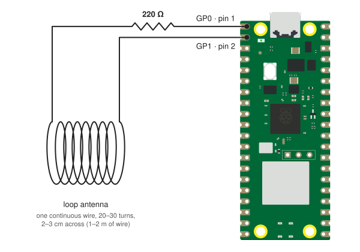

> **Note:** This is a fork of [carter-oswald-dev/Pi-pico-time-signal-generator-](https://github.com/carter-oswald-dev/Pi-pico-time-signal-generator-) (Longwave Pico), adding an unattended NTP mode and WWVB encoder fixes.

# Pico WWVB

Turns a Raspberry Pi Pico 2 W (or Pico W) into a tiny WWVB transmitter for setting radio-controlled ("atomic") clocks indoors. The Pico gets the time from NTP over Wi-Fi and transmits a 60 kHz WWVB signal through a small loop antenna placed next to the clock.

DCF77, MSF, JJY, and BPC are also supported.

## What you need

- Raspberry Pi Pico 2 W (or Pico W)
- 220 Ω resistor
- 1–2 m of thin insulated wire (bodge wire or magnet wire is fine)

## Wiring



**GP0 (pin 1) → 220 Ω → loop antenna → GP1 (pin 2)**

<sub>Pico 2 W illustration from [Pinout.xyz](https://github.com/pinout-xyz/Pinout.xyz), licensed [CC BY-SA 4.0](https://github.com/pinout-xyz/Pinout.xyz?tab=CC-BY-SA-4.0-1-ov-file); `wiring.svg` is shared under the same license.</sub>

Wind one continuous piece of wire into 20–30 turns about 2–3 cm across (around a bottle cap or marker), leaving a lead at each end. One end goes to the resistor, the other to GP1. GP0 and GP1 drive the loop in opposite directions, giving it twice the voltage swing of a single pin.

- Don't skip the resistor. At 60 kHz a small air coil is nearly a short circuit.
- The loop must be closed (both ends connected). A wire with a free end barely radiates the magnetic field the clock listens for.
- Range is a few inches, so put the loop right against the clock's movement, with the loop's axis parallel to the clock's ferrite rod antenna. Rotating the loop matters more than moving it closer.

## Setup

1. Flash MicroPython for the [Pico 2 W](https://micropython.org/download/RPI_PICO2_W/) or [Pico W](https://micropython.org/download/RPI_PICO_W/).
2. Edit `config.py` and set `WIFI_SSID` and `WIFI_PASSWORD`. Optionally change `NTP_SERVER` to a server on your LAN.
3. Copy the files to the Pico and reset it:

   ```
   mpremote cp main.py transmitter.py timecode.py ntp.py config.py :
   mpremote reset
   ```

On boot the Pico joins Wi-Fi, syncs over NTP, and starts transmitting at the next minute boundary. It re-syncs hourly to correct crystal drift. Watch progress on the serial console with `mpremote repl`.

Then put the clock into its sync mode (or power-cycle it) with the loop against it. Most clocks set themselves within 3–10 minutes.

## Options (`config.py`)

| Setting | Default | Purpose |
| --- | --- | --- |
| `PROTOCOL` | `"WWVB"` | `WWVB`, `DCF77`, `MSF`, `JJY`, or `BPC` |
| `NTP_SERVER` | `"pool.ntp.org"` | NTP server to sync from |
| `NTP_RESYNC_S` | `3600` | Seconds between NTP re-syncs |
| `TX_PINS` | `(0, 1)` | Two consecutive GPIOs for differential drive, or `(0,)` for GP0 → 220 Ω → loop → GND |

## Testing

`python3 test_wwvb.py` decodes two years of generated WWVB frames on a desktop and checks markers, time fields, and DST bits.

## License

MIT. Original project by [carter-oswald-dev](https://github.com/carter-oswald-dev/Pi-pico-time-signal-generator-); see the upstream README for full credits.
