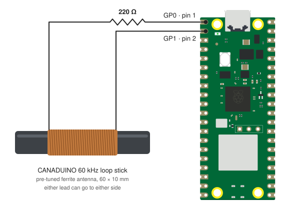
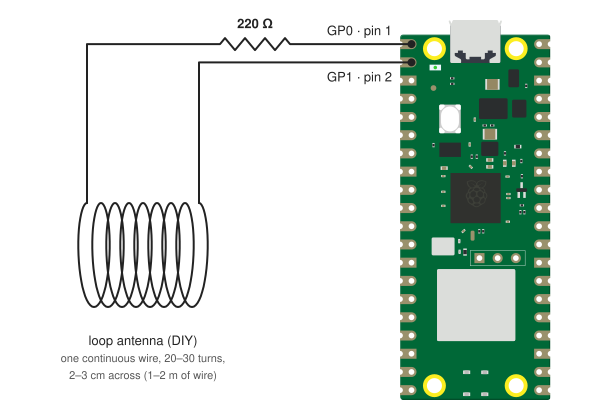

> **Note:** This is a fork of [Longwave Pico](https://github.com/carter-oswald-dev/Pi-pico-time-signal-generator-), trimmed down to an unattended, NTP-synced WWVB transmitter.

# Pico WWVB

Sets radio-controlled ("atomic") clocks indoors, where the real WWVB signal from Colorado doesn't reach. A Raspberry Pi Pico 2 W (or Pico W) gets the time over Wi-Fi and transmits a 60 kHz WWVB signal through a small antenna placed next to the clock.

## Alternatives

There are many. Before this project, I looked into [txtempus](https://github.com/hzeller/txtempus), which runs on a Pi Zero, [WatchTower](https://github.com/emmby/WatchTower) on ESP32, or [WWVB Simulator](https://www.instructables.com/WWVB-Simulator/) on STM32.

There's also a webapp you can just play on your phone or computer speakers called [Time Station Emulator](https://timestation.pages.dev).

This project doesn't intend to replace any of those, it's just my own way to scratch an itch. If it's useful to you, too? Great!

## Parts

- Raspberry Pi Pico 2 W or Pico W
- 220 Ω resistor
- An antenna, either:
  - **Option A:** a [CANADUINO® 60kHz Fine Tuned Loop Stick Antenna](https://link.amazon/B08lZciX7) (easiest, nothing to wind), or
  - **Option B:** 1–2 m of thin insulated wire (bodge wire or magnet wire) for a DIY loop

## Wiring

Both antennas wire up the same way:

**GP0 (pin 1) → 220 Ω → antenna → GP1 (pin 2)**

Don't skip the resistor. It limits the current the Pico's pins have to supply.

### Option A: CANADUINO loop stick



Solder one antenna lead to the resistor and the other to GP1; either way around works. The loop stick comes tuned to 60 kHz, so don't shorten or extend its leads.

### Option B: DIY wire loop



Wind one continuous piece of wire into 20–30 turns, 2–3 cm across (a bottle cap makes a good form), leaving a lead at each end. Connect one end to the resistor and the other to GP1.

<sub>Pico 2 W illustration from [Pinout.xyz](https://github.com/pinout-xyz/Pinout.xyz), [CC BY-SA 4.0](https://github.com/pinout-xyz/Pinout.xyz?tab=CC-BY-SA-4.0-1-ov-file). The wiring diagrams are shared under the same license.</sub>

## Placement

The clock has its own small ferrite rod antenna inside, usually lying along one edge of the movement, parallel to the clock face. It only picks up signal running along its length, so how your antenna lines up with that rod matters more than how close it is.

- **Loop stick:** lay it parallel to the clock's rod, either end to end in a line with it or side by side directly behind it. Never put it at right angles to the rod.
- **DIY loop:** best is winding the turns around the movement itself, so the clock's rod runs through the loop. Otherwise, stand the loop on edge at one end of the rod, facing along it. A loop taped flat to the back, centered on the movement, can cancel out completely.

Start close, then move the antenna away to find out how much range you have. If the clock won't sync, rotate or slide the antenna before moving it closer.

## Setup

First, make sure you have [`mpremote`](https://docs.micropython.org/en/latest/reference/mpremote.html) installed on your computer. Then:

1. Plug your Pico into your computer while holding down the 'BOOT' button. This will mount it as `RPI-RP2`.
1. Flash MicroPython for the [Pico 2 W](https://micropython.org/download/RPI_PICO2_W/) or [Pico W](https://micropython.org/download/RPI_PICO_W/) by copying the respective `UF2` file to the `RPI-RP2` mount. After the copy is finished, it will unmount and is ready for your code.
1. Copy `example.config.py` to `config.py`, then put your Wi-Fi name and password in `config.py`. Optionally, change `NTP_SERVER` to a server on your network.
1. Copy the files over and reset the Pico:

   ```
   mpremote cp main.py transmitter.py timecode.py ntp.py config.py :
   mpremote reset
   ```

The Pico starts transmitting at the next full minute and re-syncs with NTP every hour. Run `mpremote repl` to watch its progress.

The Pico's onboard LED shows its status:

| LED | Meaning |
| --- | --- |
| Solid | Connecting to Wi-Fi and syncing with NTP, then waiting for the next full minute |
| Short flash every second | Transmitting; each flash marks the start of a transmitted second |
| Fast blink | Wi-Fi or NTP sync failed (or `WIFI_SSID` isn't set); it retries every 30 seconds |

Then start a manual sync on the clock (or pull and reinsert its battery) with the antenna in place. Most clocks set themselves within 3–10 minutes.

## Testing

`python3 test_wwvb.py` checks the generated time code against Python's `datetime` for two years of minutes, including the DST changeovers.

## License

MIT, except the wiring diagrams (CC BY-SA 4.0, see above). Based on [Longwave Pico](https://github.com/carter-oswald-dev/Pi-pico-time-signal-generator-) by carter-oswald-dev.
